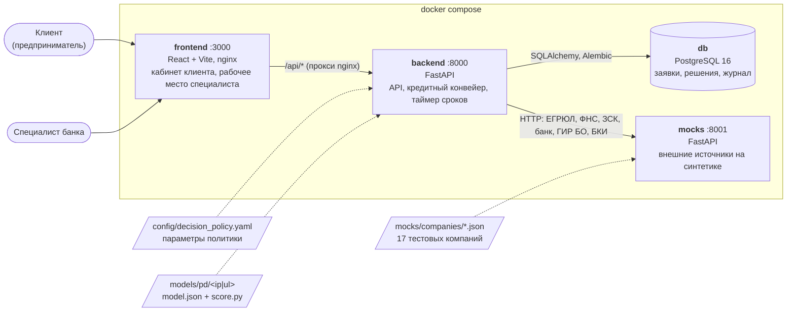
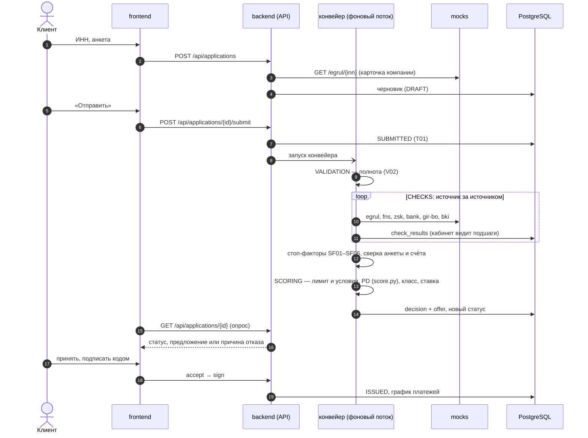

# Архитектура

## Компоненты

| Компонент | Код | Что делает |
|---|---|---|
| `frontend` | `frontend/` | Лендинг с калькулятором. Кабинет клиента: анкета, статус и подшаги, дозапросы, предложение, подписание, чат. Рабочее место специалиста: очередь, разбор заявки, решение, чаты. В контейнере nginx раздаёт статику и проксирует `/api` на бэкенд. |
| `backend` | `backend/app/` | REST API (`api/`), статусная модель (`statuses.py`, `workflow.py`), конвейер (`pipeline.py`), извлечение признаков и стоп-факторов (`features.py`), вызов модели PD (`pd_model.py`), кредитная политика (`decision.py`), тексты для клиента (`texts.py`). |
| `db` | `backend/migrations/` | Заявки, история статусов, ответы источников, решения, предложения, документы, чат. Схема — [data-model.md](data-model.md). |
| `mocks` | `mocks/app/main.py` | Заменяет ЕГРЮЛ/ЕГРИП, ФНС, ЗСК, БКИ, ГИР БО и данные банка. Умеет недоступность, таймаут и задержки (`_mock`). |
| Модель PD | `models/pd/` | Две логистические регрессии (ИП — 11 признаков, ЮЛ — 19). Вызываются из бэкенда как есть. |
| Политика | `config/decision_policy.yaml` | Все числа решения: ставки, LGD, классы риска, лимиты, стоп-факторы, сроки. Меняются без правки кода. |

## Путь заявки через систему

Конвейер работает в фоновом потоке бэкенда. После рестарта он подхватывает незаконченные заявки (`resume_unfinished`). Отдельный таймер переводит заявки в «Срок истёк», если клиент не ответил вовремя: на дозапрос — 14 дней, на предложение — 30, на подписание — 5.

## Принципы

- **Оценка риска отделена от решения.** Модель отвечает только за PD, политика — за продукты, лимиты и маршрут. Модель переобучается заменой `model.json`, политика меняется в YAML.
- **Каждое решение воспроизводимо.** В `decisions` сохраняются вход модели, вклад признаков, версии модели и политики, LGD и ограничение лимита.
- **Сбой источника не превращается в отказ.** Если источник не ответил после повторов, заявку смотрит специалист (M5).
- **Специалист получает исключения с готовой рекомендацией.** Автоматика не перезаписывает его решение (M7).

Подробности: статусы и переходы — [application-states.md](application-states.md), [диаграмма состояний](diagrams/application-states.png), [BPMN процесса](diagrams/credit-process.png); логика решения — [decision-policy.md](decision-policy.md); API — [api/openapi.json](api/openapi.json).
