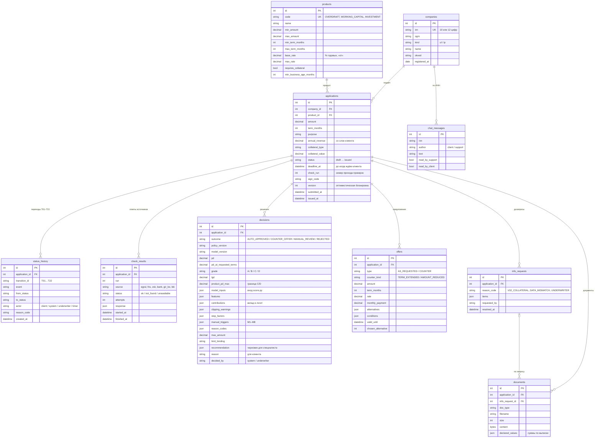

# Модель данных

Схема PostgreSQL. Источник истины — `backend/app/models.py`, миграции — `backend/migrations/versions/`.

## Таблицы

| Таблица | Что хранит | Как пишется |
|---|---|---|
| `companies` | карточка компании из реестра | при создании заявки по ответу ЕГРЮЛ/ЕГРИП |
| `products` | каталог продуктов | `app/seed.py` из `config/decision_policy.yaml` при старте |
| `applications` | заявка и её текущий статус | API и конвейер; `version` защищает от одновременных изменений (ответ 409) |
| `status_history` | каждый переход статусной модели, кто его сделал и почему | только через `workflow.fire` — других способов сменить статус нет |
| `check_results` | ответ каждого внешнего источника, число попыток, время | конвейер, шаг `CHECKS`; `run` растёт при повторной проверке после дозапроса |
| `decisions` | решение системы или специалиста со всем, что нужно для объяснения и пересчёта | конвейер (`SCORING`, стоп-факторы) и специалист |
| `offers` | условия, которые видит клиент; варианты суммы и срока | конвейер или специалист |
| `info_requests` | что банк попросил дополнить | конвейер (V02, расхождение) или специалист |
| `documents` | загруженные файлы и заявленные по ним суммы | клиент; в прототипе файл хранится прямо в БД |
| `chat_messages` | переписка с поддержкой, привязана к ИНН, а не к заявке | клиент и поддержка |

Статусы и переходы — [application-states.md](application-states.md). Значения кодов (`SF*`, `M*`, `V*`, `limit_binding`) — [decision-policy.md](decision-policy.md).
